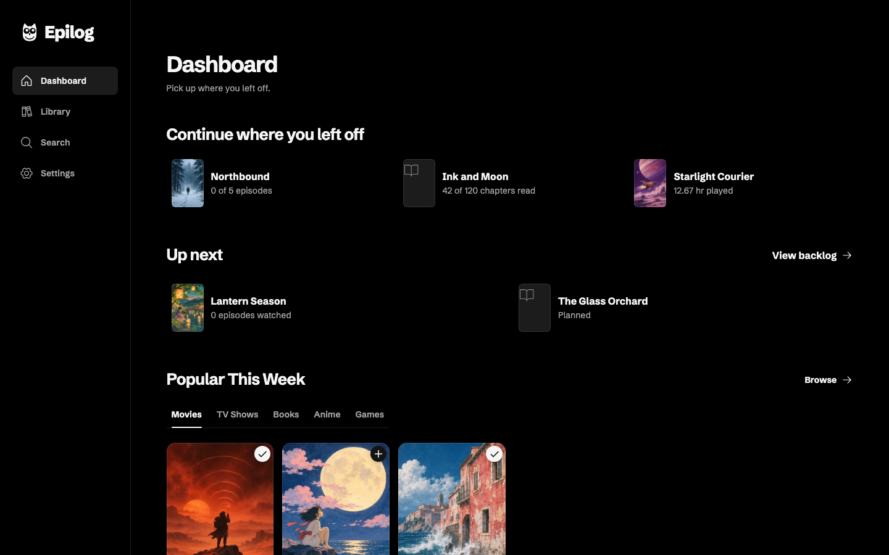
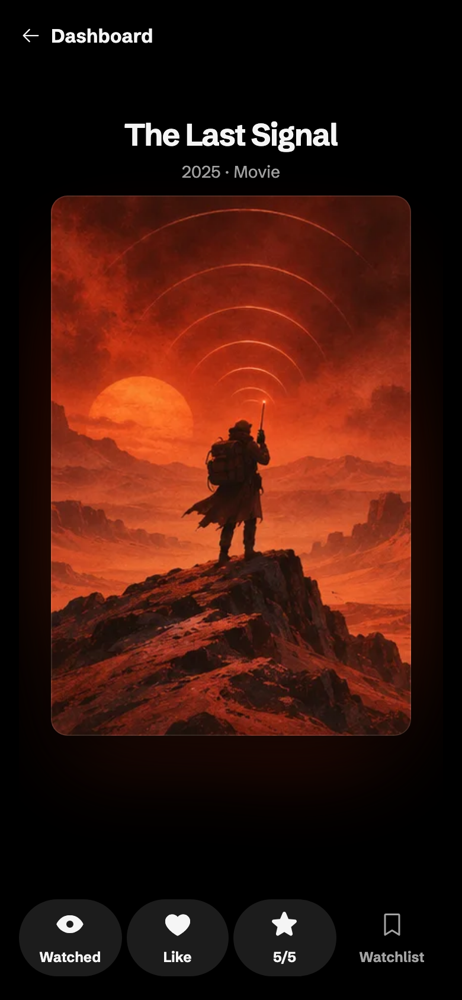

# Epilog

**Every story you love, in one place.** Movies, TV shows, anime, games, and books, tracked in one library that's beautiful, fast, and private.

**[Open Epilog →](https://epilog.pages.dev)** Free, with no account and no sign-up. Start logging in seconds.



## Stop juggling five apps

Your movies are in one app, your games in another, your reading list in a notes file, and that anime you dropped halfway is lost somewhere. Epilog brings all of it together with one library, one Dashboard, and one place to see everything you've watched, played, and read.

## Track things the way they actually work

- **🎬 Movies.** Log a watch, rate it, like it, and log a rewatch whenever you go back.
- **📺 TV and anime.** Check off episodes one at a time or finish a whole season in one click. Epilog always knows what's next.
- **🎮 Games.** Record the hours you've played, from a quick indie to a 100-hour epic.
- **📚 Books.** Novels, nonfiction, light novels, manga, manhwa, and manhua. Track progress by page, chapter, or volume, whichever fits the book.

## Find your next favorite



Every category comes with **Popular This Week**, **Highest Rated**, **Most Anticipated**, and a **Release Date** explorer that jumps to any decade or year. You can search millions of titles from TMDB, IGDB, and Open Library.

On your phone, swipe through what's popular like a deck of posters. One tap marks something watched, liked, rated, or added to your watchlist, and holding Watch logs the exact date.

## See your year in numbers

**Stats** turns your library into a story: hours watched and played, pages, chapters, and volumes read, books finished by type, your longest streak, your busiest month, and your favorite genres.

## Share your taste, not your data

Send a friend a link to your library and Epilog compares your tastes side by side. You'll see what you both loved and what they should try next. The whole profile travels inside the link, so there's no server and no account behind it.

<br clear="right">

## Yours, and only yours

- **🔒 Private by design.** Your library lives in your browser, not on our servers. There's nothing to sign up for and nothing to leak.
- **✈️ Works offline.** Install it on your phone or desktop. After one online visit, your saved titles open on a plane, on the subway, anywhere.
- **💾 Never lose a thing.** Export a backup in one tap and restore it on any device, with a preview of exactly what will change.
- **🌗 Looks great day or night.** Light, dark, or follow your system.

**Ready to build your library? [Start with Epilog now →](https://epilog.pages.dev)**

---

# For developers

## Local development

Use Node.js 22.12 or later and run `npm ci`. Create a git-ignored `.env.catalog.local` beside `package.json` with these three values.

```dotenv
TMDB_READ_ACCESS_TOKEN=
IGDB_CLIENT_ID=
IGDB_CLIENT_SECRET=
```

Get the read access token from [TMDB API Settings](https://www.themoviedb.org/settings/api). Create an application with the Confidential client type in the [Twitch Developer Console](https://dev.twitch.tv/console/apps) for IGDB. Books use Open Library’s public API, which needs no key.

Run `npm run dev` and open the Wrangler loopback URL for live catalog search and the installable PWA. Run `npm run dev:ui` for Vite hot reload with the fictional demo catalog. These modes use different local origins and maintain separate libraries.

## Verification

```sh
npx playwright install chromium
npm run build
npm run lint
npm run typecheck
npm test
npm run test:catalog
npm run deploy:check
```

`npm test` runs the unit, IndexedDB, Worker, and Chromium suites. Browser tests use synthetic provider responses. `npm run test:catalog` makes authenticated TMDB and IGDB calls using local credentials and reports coverage without writing provider responses.

## Personal deployment on Cloudflare

The public app runs at [epilog.pages.dev](https://epilog.pages.dev). Cloudflare Pages serves the Vite assets and forwards `/api/*` to the `epilog` Worker through a service binding. The Worker holds the catalog credentials, applies a per-location request limit, and has invocation logging and tracing disabled. Use the Cloudflare Free plan.

1. Authenticate with `npx wrangler login` and confirm the target account with `npx wrangler whoami`.
2. Run `npm run deploy:check` to build the app and verify the Worker bundle.
3. Run `npx wrangler deploy --secrets-file .env.catalog.local` from the project directory if the file contains only the three catalog credentials. Wrangler uploads them as server-held secrets.
4. Run `npx wrangler pages deploy --cwd pages --branch release` to publish the Pages frontend.
5. Open the Pages URL on desktop and phone. Install the app, log a title, and verify that the Library opens and accepts edits offline after its first online load.

The original Workers URL remains available for exporting an existing library. Restore that backup from Settings on the Pages URL to bring over its tracking history.

### Releases from GitHub Actions

[Release workflow](.github/workflows/release.yml) tests and deploys pushes to `release`, including merged pull requests. After Cloudflare accepts the deployment, it publishes a GitHub release and tag. The first tag comes from `package.json`. Later releases increment the latest stable tag’s patch version unless `package.json` specifies a higher version.

Create the `release` branch before the first production merge. Set `CLOUDFLARE_ACCOUNT_ID` and `CLOUDFLARE_API_TOKEN` as GitHub Actions secrets, preferably on the `production` environment. Scope the token to the Cloudflare account that owns Epilog and grant Workers Scripts Edit and Cloudflare Pages Edit. The catalog credentials stay in the deployed Worker’s secret bindings. [Cloudflare’s CI authentication guide](https://developers.cloudflare.com/workers/ci-cd/external-cicd/github-actions/#1-authentication).

Once the workflow is on GitHub’s default branch, select **Actions → Release → Run workflow** and enter an existing tag from `release` history, such as `v0.1.0`. This builds and deploys the selected revision to the production Worker and Pages project using its Wrangler configuration. It creates no additional GitHub release. [GitHub’s manual workflow guide](https://docs.github.com/en/actions/how-tos/manage-workflow-runs/manually-run-a-workflow).

Epilog sends catalog search text in a POST body. The Worker sends title queries to TMDB, IGDB, or Open Library for the selected media categories. Books can also be added manually from Search. Artwork loads from the providers’ CDNs. Personal statuses, dates, hours, episode activity, and reading progress stay in the browser.
